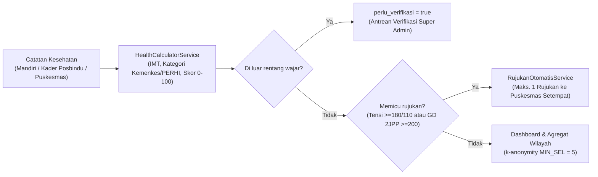

# SehatKita — Backend API Service

[](https://laravel.com)
[](https://php.net)
[](https://laravel.com/docs/sanctum)
[](../kontrak-api.md)
[](#pengujian-otomatis)

RESTful API untuk platform pemantauan dan skrining dini **Penyakit Tidak Menular (PTM)** skala kelurahan/kecamatan (studi kasus 8 kelurahan di Kecamatan Banjarbaru Utara & Banjarbaru Selatan, Kota Banjarbaru).

Seluruh endpoint berada di bawah prefix `/api/v1` dan mengacu pada [kontrak-api.md](../kontrak-api.md) sebagai satu-satunya sumber kebenaran (*single source of truth*) antara Backend dan Frontend.

---

## Alur Inti Sistem



---

## Fitur Utama Backend

- **Kalkulasi Klinis Dinamis (`HealthCalculatorService`):** Ambang kategori tidak di-*hardcode*, melainkan dibaca dari tabel `ambang_kategori` (mendukung standar Kemenkes RI / PERHI untuk tensi, IMT, gula darah puasa & 2 jam PP, kolesterol, asam urat, dan lingkar perut).
- **Deteksi Anomali & Verifikasi:** Input di luar rentang klinis wajar otomatis ditandai `perlu_verifikasi = true`, dikecualikan dari statistik rata-rata serta rujukan otomatis, hingga ditinjau `super_admin`.
- **Rujukan Otomatis (`RujukanOtomatisService`):** Pemicu rujukan otomatis ke Puskesmas kelurahan warga saat catatan sah melewati batas krisis.
- **Privasi Data Medis & k-Anonymity:**
  - Wajib persetujuan privasi (`/persetujuan`) sebelum mencatat data kesehatan atau memperbarui profil keluarga.
  - Sel agregat dengan jumlah `< 5` beserta *complementary cell* otomatis disembunyikan di endpoint `/dashboard/kelurahan` dan `/laporan/kelurahan`.
  - Identitas individu disensor pada tampilan `admin_kelurahan` (read-only untuk pengawasan wilayah) dan setiap akses data individu oleh `super_admin` dicatat ke `log_audit`.
- **Posbindu, Program Gamifikasi, & Pengaduan:** Manajemen sesi Posbindu, pencarian warga berbasis awalan NIK, program tantangan kesehatan dengan unggah foto bukti & hadiah EXP/Badge/Leaderboard, target kesehatan dinamis, serta pengaduan warga.
- **Integrasi Bot Telegram (`TelegramService`):** Pairing akun warga via token/webhook dan pengiriman pengingat skrining PTM otomatis setiap hari pukul `08:00`.
- **Ekspor Dinkes:** Unduh data CSV berstandar UTF-8 BOM via `GET /api/v1/admin/export`.

---

## Prasyarat Sistem

- **PHP:** `^8.3` (diuji berjalan di PHP 8.3 & 8.4)
- **Ekstensi PHP:** `mbstring`, `pdo_mysql`, `pdo_sqlite`, `sqlite3`, `bcmath`, `gd`, `zip`
- **Composer:** `2.8+`
- **Database:** MariaDB / MySQL (atau SQLite in-memory untuk menjalankan `php artisan test`)

---

## Panduan Instalasi & Menjalankan

### Opsi A — Menggunakan Laradock (Docker)

Jika environment memakai Laradock (`mariadb`, `redis`, `php-fpm`, `nginx`, `workspace`):

1. Pastikan konfigurasi database di `.env` mengarah ke service `mariadb`:
   ```env
   DB_CONNECTION=mysql
   DB_HOST=mariadb
   DB_PORT=3306
   DB_DATABASE=sehatkita
   DB_USERNAME=root
   DB_PASSWORD=root
   ```
2. Masuk ke container `workspace` lalu jalankan migrasi & seeder:
   ```bash
   docker exec -it laradock-workspace-1 bash
   cd /var/www/sehatkita/backend
   composer install
   cp .env.example .env   # jika belum ada
   php artisan key:generate
   php artisan migrate:fresh --seed
   ```

### Opsi B — Lokal Tanpa Docker

```bash
cd backend
composer install
cp .env.example .env
php artisan key:generate
```

Sesuaikan koneksi MySQL/MariaDB lokal di `.env` (`DB_HOST=127.0.0.1`), lalu jalankan:

```bash
php artisan migrate:fresh --seed
php artisan serve
```

Server API lokal aktif di `http://127.0.0.1:8000` (base URL API: `http://127.0.0.1:8000/api/v1`).

---

## Kredensial Akun Demo (Hasil Seeder)

Password default seluruh akun demo: **`demo1234`**

| Role | Contoh Email | Cakupan |
|---|---|---|
| **Super Admin Dinkes** | `superadmin@sehatkita.test` | Master data, statistik kota, antrean anomali, ekspor CSV, log audit |
| **Admin Kelurahan** | `admin.loktabatutara@sehatkita.test`, `admin.guntungpaikat@sehatkita.test`, *(tersedia untuk seluruh 8 kelurahan)* | Agregat kelurahan, sesi Posbindu, program kelurahan, tanggapi pengaduan |
| **Kader Posbindu** | `kader.loktabatutara@sehatkita.test`, `kader2.loktabatutara@sehatkita.test`, `kader.guntungpaikat@sehatkita.test`, `kader2.guntungpaikat@sehatkita.test` | Pencatatan peserta Posbindu, warga binaan, rujukan faskes, verifikasi bukti program |
| **Warga** | `warga.loktabatutara@sehatkita.test` (Budi Santoso), `warga.guntungpaikat@sehatkita.test` (M. Rizky Pratama), `warga.{slug}@sehatkita.test` | Catatan mandiri, grafik tren, target kesehatan, refleksi, program, pengaduan |

> Pola slug kelurahan di `PenggunaWilayahSeeder` menghilangkan spasi (huruf kecil):
> `loktabatutara`, `guntungpaikat`, `kemuning`, `loktabatselatan`, `sungaibesar`, `mentaos`, `sungaiulin`, `guntungpayung`.

---

## Scheduler & Bot Telegram

```bash
# Jalankan pengingat skrining PTM manual (terjadwal otomatis tiap 08:00 di routes/console.php)
php artisan reminder:skrining-ptm

# Jalankan worker scheduler di lokal
php artisan schedule:work

# Jalankan long-polling Bot Telegram untuk pengembangan lokal
php artisan telegram:poll
php artisan telegram:poll --once
```

---

## Pengujian Otomatis

```bash
php artisan test
```

Suite pengujian menggunakan SQLite `:memory:` yang terisolasi dan mencakup **59 tests (241 assertions)** pada `tests/Feature/` (autentikasi, otorisasi peran & wilayah, kalkulasi klinis, insight, posbindu, rujukan, program + unggah bukti, target & refleksi, pengaduan, ekspor, Telegram, dan idempotensi seeder).

---

## Struktur Direktori Utama

- `app/Http/Controllers/` — Controller API per modul kontrak (`/api/v1/*`)
- `app/Models/` — Model Eloquent (`Pengguna`, `Profil`, `CatatanKesehatan`, `Wilayah`, `Faskes`, `Indikator`, `AmbangKategori`, `SesiPosbindu`, `KunjunganPosbindu`, `Rujukan`, `Program`, `PesertaProgram`, `BadgePengguna`, `TargetKesehatan`, `Refleksi`, `Pengaduan`, `LogAudit`, `RiwayatWilayah`, `Pengobatan`)
- `app/Services/` — `HealthCalculatorService`, `InsightService`, `PeringkatService`, `RujukanOtomatisService`, `TelegramService`
- `app/Console/Commands/` — `KirimPengingatSkrining` (`reminder:skrining-ptm`), `TelegramPollCommand` (`telegram:poll`)
- `database/seeders/` — `WilayahSeeder`, `IndikatorSeeder`, `FaskesSeeder`, `PenggunaWilayahSeeder`, `WargaDummySeeder`
- `routes/api.php` & `routes/console.php` — Definisi endpoint API `/v1` dan jadwal scheduler
- `tests/Feature/` — Pengujian integrasi dan regresi API
