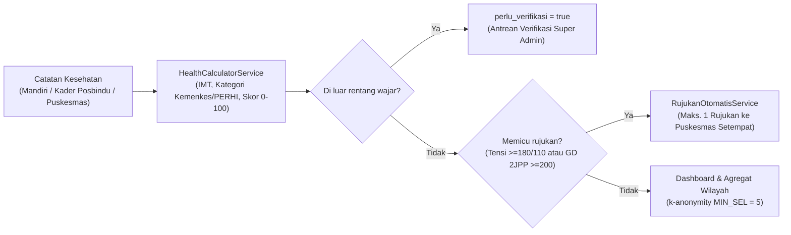

# SehatKita — Backend API Service

[](https://laravel.com)
[](https://php.net)
[](https://laravel.com/docs/sanctum)
[](../kontrak-api.md)
[](#pengujian-otomatis)

RESTful API untuk platform pemantauan dan skrining dini **Penyakit Tidak Menular (PTM)** skala kelurahan/kecamatan (studi kasus 8 kelurahan di Kecamatan Banjarbaru Utara & Banjarbaru Selatan, Kota Banjarbaru).

Seluruh endpoint berada di bawah prefix `/api/v1` dan mengacu pada [kontrak-api.md](../kontrak-api.md) sebagai satu-satunya sumber kebenaran (*single source of truth*) antara Backend dan Frontend.

---

## Alur Inti Sistem



---

## Ringkasan Kapabilitas Backend

- **Kalkulasi Klinis Dinamis (`HealthCalculatorService`):** Ambang kategori dibaca dari tabel `ambang_kategori` (mendukung standar Kemenkes RI / PERHI untuk tekanan darah, IMT, gula darah puasa & 2 jam PP, kolesterol, asam urat, dan lingkar perut).
- **Deteksi Anomali & Verifikasi:** Input di luar rentang klinis wajar otomatis ditandai `perlu_verifikasi = true`, dikecualikan dari statistik rata-rata dan rujukan otomatis, lalu masuk antrean verifikasi `super_admin`.
- **Rujukan Faskes Otomatis (`RujukanOtomatisService`):** Membuat maksimal 1 rujukan otomatis ke Puskesmas kelurahan warga saat catatan sah melewati batas krisis.
- **Privasi Data Medis & k-Anonymity:**
  - Wajib persetujuan privasi (`/persetujuan`) untuk mencatat kesehatan baru dan memperbarui profil keluarga.
  - Sel agregat `< 5` beserta *complementary cell* disembunyikan pada `/dashboard/kelurahan` dan `/laporan/kelurahan`.
  - Identitas individu disensor pada tampilan `admin_kelurahan` (read-only), dan akses/aksi sensitif `super_admin` tercatat ke `log_audit`.
- **Posbindu, Program Gamifikasi, & Pengaduan:** Jadwal Posbindu, autocomplete NIK 16 digit, tantangan program dengan unggah foto bukti & hadiah EXP/Badge/Peringkat, target dinamis, refleksi mingguan, serta layanan pengaduan warga.
- **Integrasi Bot Telegram (`TelegramService`):** Pairing akun warga via webhook/polling dan pengingat skrining PTM harian otomatis pukul `08:00`.
- **Ekspor Dinkes:** Unduh rekapitulasi CSV berstandar UTF-8 BOM (`catatan`, `posbindu`, `rujukan`).

---

## Daftar Lengkap Fitur & Endpoint API (`/api/v1`)

Seluruh endpoint terproteksi mewajibkan header `Authorization: Bearer <token>` (Laravel Sanctum) dan mengembalikan amplop JSON standar:
- Tunggal: `{ "success": true, "message": "...", "data": { ... } }`
- Paginasi: `{ "success": true, "message": "...", "data": [ ... ], "meta": { "page": 1, "per_page": 15, "total": ..., "last_page": ... } }`

### 1. Rute Publik (Tanpa Login)

| Method | Endpoint | Controller | Keterangan |
|---|---|---|---|
| `POST` | `/api/v1/auth/register` | `AuthController@register` | Registrasi warga baru (`role: user`), validasi NIK 16 digit & `wilayah_id` kelurahan (`throttle:10,1`) |
| `POST` | `/api/v1/auth/login` | `AuthController@login` | Autentikasi akun & penerbitan Bearer token Sanctum (`throttle:5,1`) |
| `GET` | `/api/v1/wilayah` | `WilayahController@index` | Daftar kecamatan & kelurahan (filter `?tipe=`, `?parent_id=`, `?search=` / `?q=`) |
| `POST` | `/api/v1/telegram/webhook` | `TelegramController@webhook` | Webhook Bot Telegram untuk menerima perintah `/start <token>` pairing warga |

### 2. Autentikasi, Persetujuan Privasi, & Profil (`auth:sanctum`)

| Method | Endpoint | Peran | Keterangan |
|---|---|---|---|
| `GET` | `/api/v1/auth/me` | Semua login | Mengambil data akun pengguna yang sedang login |
| `POST` | `/api/v1/auth/logout` | Semua login | Mencabut token Bearer aktif |
| `POST` | `/api/v1/persetujuan` | Semua login | Menyimpan persetujuan kebijakan privasi data medis (`consent_at`) |
| `DELETE` | `/api/v1/persetujuan` | Semua login | Menarik persetujuan privasi; menghentikan pencatatan baru & mengeluarkan warga dari agregat/peringkat |
| `GET` | `/api/v1/profil` | Semua login | Membaca profil kesehatan, `usia` terhitung otomatis, riwayat keluarga, & preferensi |
| `PUT` | `/api/v1/profil` | Semua login | Memperbarui profil kesehatan, riwayat keluarga, & target awal (wajib consent aktif) |

### 3. Integrasi Bot Telegram & Referensi Wilayah/Faskes

| Method | Endpoint | Peran | Keterangan |
|---|---|---|---|
| `GET` | `/api/v1/telegram/status` | Semua login | Mengecek status koneksi Telegram serta token/tautan pairing |
| `POST` | `/api/v1/telegram/putuskan` | Semua login | Memutuskan tautan akun Telegram dari akun warga |
| `GET` | `/api/v1/wilayah/{id}` | Terotorisasi (`view-wilayah`) | Detail data wilayah kecamatan/kelurahan |
| `GET` | `/api/v1/faskes` | Semua login | Daftar faskes (filter `?wilayah_id=`, `?search=` / `?q=`) |

### 4. Catatan Kesehatan, Insight Klinis, & Grafik Tren

| Method | Endpoint | Peran | Keterangan |
|---|---|---|---|
| `GET` | `/api/v1/catatan-kesehatan` | Semua login (`admin_kelurahan` read-only) | Daftar riwayat pemeriksaan sesuai cakupan role (filter `?user_id=`, `?sumber=`, `?dari=`, `?sampai=`, `?indikator=`, `?search=`) |
| `POST` | `/api/v1/catatan-kesehatan` | `user`, `kader`, `super_admin` | Menyimpan catatan baru, hitung snapshot kategori & skor risiko, deteksi anomali, serta pemicu rujukan otomatis |
| `GET` | `/api/v1/catatan-kesehatan/{catatan_kesehatan}` | Sesuai cakupan akses | Detail 1 catatan kesehatan (`super_admin` yang melihat data orang lain dicatat ke `log_audit`) |
| `DELETE` | `/api/v1/catatan-kesehatan/{catatan_kesehatan}` | `user` (milik sendiri), `kader` (binaan), `super_admin` | Menghapus lunak (*soft delete*) catatan kesehatan |
| `GET` | `/api/v1/insight` | Semua login | Insight edukasi/peringatan berbasis catatan terakhir (mendukung multi-filter `?level=peringatan,bahaya`) |
| `GET` | `/api/v1/insight/ambang` | Semua login | Daftar ambang batas kategori aktif dari master indikator |
| `GET` | `/api/v1/tren` | Sesuai role | Deret waktu indikator kesehatan untuk grafik tren frontend |
| `GET` | `/api/v1/rekam-medis` | Sesuai role | Alias `/tren` untuk kebutuhan halaman rekam medis |

### 5. Rujukan Fasilitas Kesehatan

| Method | Endpoint | Peran | Keterangan |
|---|---|---|---|
| `GET` | `/api/v1/rujukan` | Semua login | Daftar rujukan sesuai role/wilayah (identitas disensor untuk `admin_kelurahan`; filter `?status=`, tanggal, & cari faskes/indikator) |
| `POST` | `/api/v1/rujukan` | `kader`, `super_admin` | Membuat rujukan faskes manual untuk warga di wilayah kerjanya |
| `PATCH` | `/api/v1/rujukan/{id}/status` | `kader`, `admin_kelurahan`, `super_admin` | Memperbarui status (`baru` -> `dihubungi` -> `tertangani`/`ditolak`; penolakan wajib `catatan`) + catat `log_audit` |

### 6. Posbindu & Pencarian NIK

| Method | Endpoint | Peran | Keterangan |
|---|---|---|---|
| `GET` | `/api/v1/posbindu/sesi` | `kader`, `admin_kelurahan`, `super_admin` | Daftar jadwal sesi Posbindu (filter & pencarian `lokasi`/`catatan`) |
| `POST` | `/api/v1/posbindu/sesi` | `kader`, `admin_kelurahan`, `super_admin` | Membuat jadwal sesi Posbindu baru |
| `GET` | `/api/v1/posbindu/sesi/{id}` | `kader`, `admin_kelurahan`, `super_admin` | Detail sesi & peserta (`peserta` disensor menjadi `[]` untuk `admin_kelurahan`) |
| `PUT` | `/api/v1/posbindu/sesi/{id}` | `kader`, `admin_kelurahan`, `super_admin` | Memperbarui jadwal/status sesi Posbindu |
| `DELETE` | `/api/v1/posbindu/sesi/{id}` | `kader`, `admin_kelurahan`, `super_admin` | Menghapus sesi (ditolak `422` bila sudah memiliki catatan pemeriksaan) |
| `POST` | `/api/v1/posbindu/sesi/{id}/peserta` | `kader`, `super_admin` | Mencatat kehadiran peserta sekaligus menyimpan hasil skrining kesehatannya |
| `GET` | `/api/v1/posbindu/kunjungan` | Semua login | Riwayat kunjungan sesi Posbindu (warga hanya melihat miliknya) |
| `GET` | `/api/v1/posbindu/peserta/cari-nik` | `kader`, `admin_kelurahan`, `super_admin` | Autocomplete pencarian warga berbasis awalan NIK / nama |
| `GET` | `/api/v1/pengguna/cari-nik` | `kader`, `admin_kelurahan`, `super_admin` | Alias endpoint pencarian warga berbasis NIK / nama |

### 7. Program Kesehatan, Bukti Aktivitas, & Peringkat

| Method | Endpoint | Peran | Keterangan |
|---|---|---|---|
| `GET` | `/api/v1/program` | Semua login | Daftar program global & kelurahan (pencarian `judul`/`kategori_aktivitas`) |
| `POST` | `/api/v1/program` | `admin_kelurahan`, `super_admin` | Membuat program baru (kelurahan otomatis untuk wilayah sendiri; `super_admin` bisa global) |
| `GET` | `/api/v1/program/{id}` | Semua login | Detail program dan status keikutsertaan pengguna |
| `PUT` / `PATCH` | `/api/v1/program/{id}` | `admin_kelurahan`, `super_admin` | Mengubah detail, jadwal, kuota, atau reward program |
| `DELETE` | `/api/v1/program/{id}` | `admin_kelurahan`, `super_admin` | Menghapus program |
| `GET` | `/api/v1/program/{id}/peserta` | `kader`, `admin_kelurahan`, `super_admin` | Daftar peserta program beserta status & catatan bukti |
| `POST` | `/api/v1/program/{id}/peserta` | `user` | Mendaftar ke program (memvalidasi kelurahan & kuota `target_peserta`) |
| `PATCH` | `/api/v1/program/{id}/peserta` | `kader`, `admin_kelurahan`, `super_admin` | Verifikasi/ubah status peserta (`selesai` otomatis menambah EXP, level, & badge) |
| `POST` | `/api/v1/program/{id}/bukti` | `user` | Mengunggah foto bukti aktivitas & catatan penyelesaian misi |
| `GET` | `/api/v1/program/{id}/bukti/{pesertaId}` | `user` (pemilik), `kader`, `admin_kelurahan`, `super_admin` | Mengakses/menampilkan file foto bukti peserta |
| `GET` | `/api/v1/peringkat` | Semua login | Papan peringkat EXP & level kelurahan (khusus warga consenting & `tampil_di_peringkat = true`) |

### 8. Target Kesehatan & Refleksi Mingguan

| Method | Endpoint | Peran | Keterangan |
|---|---|---|---|
| `GET` | `/api/v1/target` | Semua login | Membaca target berat badan, aktivitas, & air minum dari profil |
| `PUT` | `/api/v1/target` | `user` | Memperbarui target profil (otomatis mengisi `bb_awal_kg` dari berat terakhir jika belum ada) |
| `GET` | `/api/v1/refleksi` | `user` | Daftar catatan refleksi mingguan milik warga |
| `POST` | `/api/v1/refleksi` | `user` | Menyimpan refleksi mingguan (format minggu ISO `YYYY-Www`) |
| `GET` | `/api/v1/target-kesehatan` | `user` | Daftar target kesehatan dinamis multi-metrik (filter opsional `?tercapai=`) |
| `POST` | `/api/v1/target-kesehatan` | `user` | Membuat target kesehatan dinamis baru |
| `PUT` | `/api/v1/target-kesehatan/{id}` | `user` | Mengubah nilai target, tenggat waktu, atau catatan motivasi |
| `PATCH` | `/api/v1/target-kesehatan/{id}/capai` | `user` | Menandai ketercapaian target kesehatan |
| `DELETE` | `/api/v1/target-kesehatan/{id}` | `user` | Menghapus target kesehatan |

### 9. Pengaduan Warga

| Method | Endpoint | Peran | Keterangan |
|---|---|---|---|
| `GET` | `/api/v1/pengaduan` | `user`, `admin_kelurahan`, `super_admin` | Daftar pengaduan sesuai role/wilayah (filter `?status=`, `?kategori=`, `?search=`) |
| `POST` | `/api/v1/pengaduan` | `user` | Mengirim pengaduan/aspirasi baru (`layanan_posbindu`, `faskes`, `rujukan`, `aplikasi`, `lainnya`) |
| `GET` | `/api/v1/pengaduan/{id}` | `user`, `admin_kelurahan`, `super_admin` | Detail pengaduan beserta tanggapan resmi |
| `PATCH` | `/api/v1/pengaduan/{id}/tanggapi` | `admin_kelurahan`, `super_admin` | Memberi tanggapan & memperbarui status (`diproses`, `selesai`, `ditolak`) |

### 10. Dashboard & Laporan

| Method | Endpoint | Peran | Keterangan |
|---|---|---|---|
| `GET` | `/api/v1/dashboard/pribadi` | `user` | Ringkasan kondisi terkini, perbandingan dengan bulan lalu, target, & rujukan aktif |
| `GET` | `/api/v1/dashboard/kelurahan` | `admin_kelurahan`, `super_admin` | Statistik agregat kelurahan (IMT, kelompok usia, riwayat keluarga, rujukan, kepatuhan, tren) dengan proteksi k-anonymity |
| `GET` | `/api/v1/laporan/pribadi` | `user` | Data laporan ringkasan pribadi siap cetak di frontend |
| `GET` | `/api/v1/laporan/kelurahan` | `admin_kelurahan`, `super_admin` | Data laporan agregat kelurahan beserta *disclaimer* medis |

### 11. Administrasi, Master Data, Audit, & Ekspor (`super_admin`)

Seluruh rute di bawah ini berada di prefix `/api/v1/admin` dan hanya dapat diakses oleh `super_admin`:

| Method | Endpoint | Controller | Keterangan |
|---|---|---|---|
| `GET` | `/api/v1/admin/statistik` | `AdminStatistikController@index` | Ringkasan global: pengguna per role, rujukan, program, rata-rata IMT/tensi terverifikasi, aktivitas 7 hari |
| `GET` | `/api/v1/admin/export` | `AdminExportController@export` | Streaming unduhan CSV (UTF-8 BOM) untuk `?tipe=catatan`, `posbindu`, atau `rujukan` |
| `GET` | `/api/v1/admin/indikator` | `AdminMasterController@indexIndikator` | Daftar master indikator kesehatan |
| `POST` | `/api/v1/admin/indikator` | `AdminMasterController@storeIndikator` | Tambah master indikator & `interval_skrining_hari` |
| `PUT` | `/api/v1/admin/indikator/{id}` | `AdminMasterController@updateIndikator` | Ubah master indikator |
| `DELETE` | `/api/v1/admin/indikator/{id}` | `AdminMasterController@destroyIndikator` | Hapus master indikator |
| `GET` | `/api/v1/admin/ambang-kategori` | `AdminMasterController@indexAmbang` | Daftar ambang batas kategori klinis |
| `POST` | `/api/v1/admin/ambang-kategori` | `AdminMasterController@storeAmbang` | Tambah aturan ambang kategori & pemicu rujukan (reset cache) |
| `PUT` | `/api/v1/admin/ambang-kategori/{id}` | `AdminMasterController@updateAmbang` | Ubah aturan ambang kategori (reset cache) |
| `DELETE` | `/api/v1/admin/ambang-kategori/{id}` | `AdminMasterController@destroyAmbang` | Hapus aturan ambang kategori (reset cache) |
| `GET` | `/api/v1/admin/pengguna` | `AdminMasterController@indexPengguna` | Daftar & pencarian pengguna lintas role dan wilayah |
| `POST` | `/api/v1/admin/pengguna` | `AdminMasterController@storePengguna` | Buat akun pengguna baru (`super_admin`, `admin_kelurahan`, `kader`, `user`) |
| `GET` | `/api/v1/admin/pengguna/{id}/riwayat-wilayah` | `AdminMasterController@riwayatWilayahPengguna` | Riwayat mutasi wilayah pengguna |
| `PUT` | `/api/v1/admin/pengguna/{id}` | `AdminMasterController@updatePengguna` | Ubah data akun, status `aktif`, `role`, `kader_id`, atau mutasi `wilayah_id` (mencatat `riwayat_wilayah`) |
| `DELETE` | `/api/v1/admin/pengguna/{id}` | `AdminMasterController@destroyPengguna` | Hapus akun pengguna |
| `GET` | `/api/v1/admin/faskes` | `AdminMasterController@indexFaskes` | Daftar master faskes |
| `POST` | `/api/v1/admin/faskes` | `AdminMasterController@storeFaskes` | Tambah faskes baru (`puskesmas`, `klinik`, `rumah_sakit`, `lainnya`) |
| `PUT` | `/api/v1/admin/faskes/{id}` | `AdminMasterController@updateFaskes` | Ubah data faskes |
| `DELETE` | `/api/v1/admin/faskes/{id}` | `AdminMasterController@destroyFaskes` | Hapus faskes |
| `GET` | `/api/v1/admin/log-audit` | `AdminMasterController@indexLogAudit` | Daftar jejak audit aktivitas sensitif (mendukung pencarian `aksi`/`model`) |
| `GET` | `/api/v1/admin/catatan-kesehatan/perlu-verifikasi` | `CatatanKesehatanController@perluVerifikasiList` | Daftar antrean catatan anomali (`perlu_verifikasi = true`, filter opsional `?wilayah_id=`) |
| `PATCH` | `/api/v1/admin/catatan-kesehatan/{id}/verifikasi` | `CatatanKesehatanController@verifikasi` | Keputusan verifikasi catatan anomali (`setuju`: validasi data, `tolak`: hapus catatan) + catat `log_audit` |

---

## Prasyarat Sistem

- **PHP:** `^8.3` (diuji berjalan di PHP 8.3 & 8.4)
- **Ekstensi PHP:** `mbstring`, `pdo_mysql`, `pdo_sqlite`, `sqlite3`, `bcmath`, `gd`, `zip`
- **Composer:** `2.8+`
- **Database:** MariaDB / MySQL (atau SQLite in-memory untuk menjalankan `php artisan test`)

---

## Panduan Instalasi & Menjalankan

### Opsi A — Menggunakan Laradock (Docker)

Jika environment memakai Laradock (`mariadb`, `redis`, `php-fpm`, `nginx`, `workspace`):

1. Pastikan konfigurasi database di `.env` mengarah ke service `mariadb`:
   ```env
   DB_CONNECTION=mysql
   DB_HOST=mariadb
   DB_PORT=3306
   DB_DATABASE=sehatkita
   DB_USERNAME=root
   DB_PASSWORD=root
   ```
2. Masuk ke container `workspace` lalu jalankan migrasi & seeder:
   ```bash
   docker exec -it laradock-workspace-1 bash
   cd /var/www/sehatkita/backend
   composer install
   cp .env.example .env   # jika belum ada
   php artisan key:generate
   php artisan migrate:fresh --seed
   ```

### Opsi B — Lokal Tanpa Docker

```bash
cd backend
composer install
cp .env.example .env
php artisan key:generate
```

Sesuaikan koneksi MySQL/MariaDB lokal di `.env` (`DB_HOST=127.0.0.1`), lalu jalankan:

```bash
php artisan migrate:fresh --seed
php artisan serve
```

Server API lokal aktif di `http://127.0.0.1:8000` (base URL API: `http://127.0.0.1:8000/api/v1`).

---

## Kredensial Akun Demo (Hasil Seeder)

Password default seluruh akun demo: **`demo1234`**

| Role | Contoh Email | Cakupan |
|---|---|---|
| **Super Admin Dinkes** | `superadmin@sehatkita.test` | Master data, statistik kota, antrean anomali, ekspor CSV, log audit |
| **Admin Kelurahan** | `admin.loktabatutara@sehatkita.test`, `admin.guntungpaikat@sehatkita.test`, *(tersedia untuk seluruh 8 kelurahan)* | Agregat kelurahan, sesi Posbindu, program kelurahan, tanggapi pengaduan |
| **Kader Posbindu** | `kader.loktabatutara@sehatkita.test`, `kader2.loktabatutara@sehatkita.test`, `kader.guntungpaikat@sehatkita.test`, `kader2.guntungpaikat@sehatkita.test` | Pencatatan peserta Posbindu, warga binaan, rujukan faskes, verifikasi bukti program |
| **Warga** | `warga.loktabatutara@sehatkita.test` (Budi Santoso), `warga.guntungpaikat@sehatkita.test` (M. Rizky Pratama), `warga.{slug}@sehatkita.test` | Catatan mandiri, grafik tren, target kesehatan, refleksi, program, pengaduan |

> Pola slug kelurahan di `PenggunaWilayahSeeder` menghilangkan spasi (huruf kecil):
> `loktabatutara`, `guntungpaikat`, `kemuning`, `loktabatselatan`, `sungaibesar`, `mentaos`, `sungaiulin`, `guntungpayung`.

---

## Scheduler & Bot Telegram

```bash
# Jalankan pengingat skrining PTM manual (terjadwal otomatis tiap 08:00 di routes/console.php)
php artisan reminder:skrining-ptm

# Jalankan worker scheduler di lokal
php artisan schedule:work

# Jalankan long-polling Bot Telegram untuk pengembangan lokal
php artisan telegram:poll
php artisan telegram:poll --once
```

---

## Pengujian Otomatis

```bash
php artisan test
```

Suite pengujian menggunakan SQLite `:memory:` yang terisolasi dan mencakup **59 tests (241 assertions)** pada `tests/Feature/` (autentikasi, otorisasi peran & wilayah, kalkulasi klinis, insight, posbindu, rujukan, program + unggah bukti, target & refleksi, pengaduan, ekspor, Telegram, dan idempotensi seeder).

---

## Struktur Direktori Utama

- `app/Http/Controllers/` — Controller API per modul kontrak (`/api/v1/*`)
- `app/Models/` — Model Eloquent (`Pengguna`, `Profil`, `CatatanKesehatan`, `Wilayah`, `Faskes`, `Indikator`, `AmbangKategori`, `SesiPosbindu`, `KunjunganPosbindu`, `Rujukan`, `Program`, `PesertaProgram`, `BadgePengguna`, `TargetKesehatan`, `Refleksi`, `Pengaduan`, `LogAudit`, `RiwayatWilayah`, `Pengobatan`)
- `app/Services/` — `HealthCalculatorService`, `InsightService`, `PeringkatService`, `RujukanOtomatisService`, `TelegramService`
- `app/Console/Commands/` — `KirimPengingatSkrining` (`reminder:skrining-ptm`), `TelegramPollCommand` (`telegram:poll`)
- `database/seeders/` — `WilayahSeeder`, `IndikatorSeeder`, `FaskesSeeder`, `PenggunaWilayahSeeder`, `WargaDummySeeder`
- `routes/api.php` & `routes/console.php` — Definisi endpoint API `/v1` dan jadwal scheduler
- `tests/Feature/` — Pengujian integrasi dan regresi API
