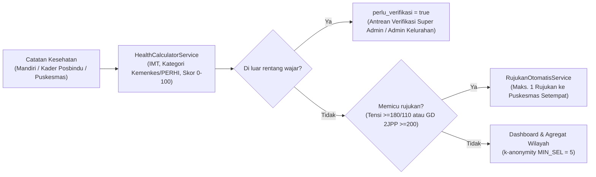

# SehatKita — Platform Pemantauan & Skrining Dini PTM

[](https://laravel.com)
[](https://php.net)
[](https://laravel.com/docs/sanctum)
[](https://nextjs.org)
[](https://react.dev)
[](https://www.typescriptlang.org)
[](./kontrak-api.md)
[](#pengujian-otomatis)
[](#pengujian-otomatis)

Platform pemantauan dan skrining dini **Penyakit Tidak Menular (PTM)** skala kelurahan/kecamatan (studi kasus 8 kelurahan di Kecamatan Banjarbaru Utara & Banjarbaru Selatan, Kota Banjarbaru). Monorepo ini terdiri atas tiga komponen utama yang saling terhubung:

- **Backend API (`backend/`):** Laravel 13 + Sanctum REST API ([backend/README.md](./backend/README.md)).
- **Frontend Web (`frontend/`):** Next.js 16 (App Router) + React 19 + TypeScript ([frontend/README.md](./frontend/README.md)).
- **Bot Telegram (`telegram:poll` & `reminder:skrining-ptm`):** Pairing akun warga dan pengiriman pengingat skrining PTM, Posbindu H-1, dan tenggat target harian.

Seluruh endpoint berada di bawah prefix `/api/v1` dan mengacu pada [kontrak-api.md](./kontrak-api.md) (`v1.8.4`) sebagai satu-satunya sumber kebenaran (*single source of truth*) antara Backend dan Frontend.

---

## Prasyarat Sistem

- **Backend:**
  - **PHP:** `^8.3` (diuji berjalan di PHP 8.3 & 8.4)
  - **Ekstensi PHP:** `mbstring`, `pdo_mysql`, `pdo_sqlite`, `sqlite3`, `bcmath`, `gd`, `zip`
  - **Composer:** `2.8+`
  - **Database:** MariaDB / MySQL (atau SQLite in-memory untuk `php artisan test`)
- **Frontend:**
  - **Node.js:** `20+` dan `npm`
- **Docker (Opsional):** Laradock (`nginx`, `php-fpm`, `mariadb`, `redis`, `workspace`) untuk menjalankan seluruh stack pada domain lokal `http://sehatkita.test`.
- **Bot Telegram:** Token bot (`TELEGRAM_BOT_TOKEN`) dan username bot (`TELEGRAM_BOT_USERNAME`) dari `@BotFather` yang diisikan ke `backend/.env`.

---

## Cara Menjalankan Aplikasi (Backend + Frontend + Bot Telegram)

### Opsi A — Menggunakan Laradock / Docker (`http://sehatkita.test`)

Pada konfigurasi Nginx Laradock (`/etc/nginx/sites-available/sehatkita.conf`), request ke `/api/*`, `/sanctum/*`, dan `/storage/*` diteruskan ke container `laradock-php-fpm-1` (Backend Laravel), sedangkan `/` diteruskan (*proxy*) ke Frontend Next.js di host port **`3002`** (`http://host.docker.internal:3002`).

#### 1. Jalankan Backend (Docker Laradock)

Pastikan container Laradock (`nginx`, `php-fpm`, `mariadb`, `redis`, `workspace`) sudah aktif, dan `backend/.env` sudah mengarah ke service database Laradock serta token Telegram:

```env
DB_CONNECTION=mysql
DB_HOST=mariadb
DB_PORT=3306
DB_DATABASE=sehatkita
DB_USERNAME=root
DB_PASSWORD=root

TELEGRAM_BOT_TOKEN=<token_dari_botfather>
TELEGRAM_BOT_USERNAME=<username_bot_tanpa_at>
```

Jalankan instalasi awal (sekali saja atau saat reset database) di dalam container `laradock-workspace-1`:

```bash
docker exec -it laradock-workspace-1 bash -lc "cd /var/www/sehatkita/backend && composer install && cp -n .env.example .env && php artisan key:generate && php artisan migrate:fresh --seed"
```

Bersihkan cache Laravel apabila ada perubahan konfigurasi atau route:

```bash
docker exec -it laradock-workspace-1 bash -lc "cd /var/www/sehatkita/backend && php artisan optimize:clear"
```

#### 2. Jalankan Frontend (Terminal 1 — Host)

Pastikan `frontend/.env.local` berisi alamat API Laradock:

```env
NEXT_PUBLIC_API_URL=http://sehatkita.test/api/v1
NEXT_PUBLIC_API_BASE_URL=http://sehatkita.test/api/v1
```

Lalu jalankan Next.js di port **`3002`** (port yang dituju Nginx Laradock):

```bash
cd frontend
npm install
npx next dev -p 3002
# Atau mode produksi:
# npm run build && npx next start -p 3002
```

Aplikasi web dapat diakses melalui: **`http://sehatkita.test`**

#### 3. Jalankan Bot Telegram (Terminal 2 & 3 — di dalam `laradock-workspace-1`)

> Karena `backend/.env` pada setup Laradock memakai `DB_HOST=mariadb`, perintah artisan Bot Telegram dan scheduler **harus dijalankan di dalam container `laradock-workspace-1`** agar dapat mengakses database dan cache lock (`Cache::lock`).

```bash
# Terminal 2 — Long-polling Bot Telegram untuk menerima perintah /start <token> saat pairing warga
docker exec -it laradock-workspace-1 bash -lc "cd /var/www/sehatkita/backend && php artisan telegram:poll"
# (Gunakan --once jika hanya ingin memeriksa pembaruan satu kali lalu keluar)

# Terminal 3 (Opsional) — Worker scheduler pengingat harian otomatis pukul 08:00 (routes/console.php)
docker exec -it laradock-workspace-1 bash -lc "cd /var/www/sehatkita/backend && php artisan schedule:work"
```

Untuk menguji pengiriman pengingat manual sekali jalan (skrining PTM > 30 hari, Posbindu H-1, dan tenggat target hari ini):

```bash
docker exec -it laradock-workspace-1 bash -lc "cd /var/www/sehatkita/backend && php artisan reminder:skrining-ptm"
```

---

### Opsi B — Lokal Tanpa Docker (`127.0.0.1:8000` & `localhost:3000`)

#### 1. Backend (Terminal 1)

Salin `backend/.env.example` menjadi `backend/.env`, sesuaikan `DB_HOST=127.0.0.1` + kredensial MySQL/MariaDB lokal serta `TELEGRAM_BOT_TOKEN` & `TELEGRAM_BOT_USERNAME`, lalu jalankan:

```bash
cd backend
composer install
cp .env.example .env
php artisan key:generate
php artisan migrate:fresh --seed
php artisan serve
```

Backend API lokal aktif di `http://127.0.0.1:8000` (base URL API: `http://127.0.0.1:8000/api/v1`).

#### 2. Frontend (Terminal 2)

Salin `frontend/.env.example` menjadi `frontend/.env.local`, atur `API_PROXY_TARGET=http://127.0.0.1:8000`, dan pastikan `NEXT_PUBLIC_API_URL` **kosong/dikomentari** agar seluruh request `/api/v1/*` diteruskan lewat rewrite proxy Next.js (`frontend/next.config.ts`) tanpa masalah CORS:

```bash
cd frontend
npm install
cp .env.example .env.local
npm run dev
```

Frontend lokal aktif di `http://localhost:3000` (atau `npx next dev -p 3002` untuk port `3002`).

#### 3. Bot Telegram (Terminal 3 & 4)

```bash
# Terminal 3 — Long-polling Bot Telegram
cd backend
php artisan telegram:poll

# Terminal 4 (Opsional) — Scheduler pengingat harian pukul 08:00
cd backend
php artisan schedule:work
```

### Alur Singkat Pairing Bot Telegram

1. Pastikan `TELEGRAM_BOT_TOKEN` & `TELEGRAM_BOT_USERNAME` sudah terisi di `backend/.env` dan `php artisan telegram:poll` sedang berjalan (atau webhook `/api/v1/telegram/webhook` aktif pada server publik).
2. Login di Frontend sebagai akun warga (role `user`), lalu buka halaman **`/setelan`** atau **`/profil`**.
3. Klik tombol/tautan **Hubungkan Telegram** (`https://t.me/<username_bot>?start=<token>`), lalu tekan **Start** di aplikasi Telegram.
4. Bot memproses perintah `/start <token>`, menautkan `telegram_chat_id` ke akun warga, dan mengirimkan pesan konfirmasi.

---

## Kredensial Akun Demo (Hasil Seeder)

Password default seluruh akun demo hasil `PenggunaWilayahSeeder` & `WargaDummySeeder`: **`demo1234`**

| Role | Contoh Email | Cakupan |
|---|---|---|
| **Super Admin Dinkes** | `superadmin@sehatkita.test` | Master data, statistik kota, verifikasi anomali, ekspor CSV, log audit |
| **Admin Kelurahan** | `admin.loktabatutara@sehatkita.test`, `admin.guntungpaikat@sehatkita.test` *(tersedia untuk seluruh 8 kelurahan)* | Agregat kelurahan, sesi Posbindu, program kelurahan, verifikasi catatan anomali kelurahan, tanggapi pengaduan |
| **Kader Posbindu** | `kader.loktabatutara@sehatkita.test`, `kader2.loktabatutara@sehatkita.test`, `kader.guntungpaikat@sehatkita.test`, `kader2.guntungpaikat@sehatkita.test` | Pencatatan peserta Posbindu, warga binaan, rujukan faskes, verifikasi bukti program |
| **Warga** | `warga.loktabatutara@sehatkita.test` (Budi Santoso), `warga.guntungpaikat@sehatkita.test` (M. Rizky Pratama), `warga.{slug}@sehatkita.test` | Catatan mandiri, grafik tren, target kesehatan, refleksi, program, pengaduan |

> Pola slug kelurahan di `PenggunaWilayahSeeder` menghilangkan spasi (huruf kecil):
> `loktabatutara`, `guntungpaikat`, `kemuning`, `loktabatselatan`, `sungaibesar`, `mentaos`, `sungaiulin`, `guntungpayung`.

---

## Alur Inti Sistem



---

## Ringkasan Kapabilitas Sistem

### Backend API & Layanan
- **Kalkulasi Klinis Dinamis (`HealthCalculatorService`):** Ambang kategori dibaca dari tabel `ambang_kategori` sesuai standar Kemenkes RI / PERHI (termasuk ambang IMT Permenkes No. 41 Tahun 2014 untuk tekanan darah, IMT, gula darah puasa & 2 jam PP, kolesterol, asam urat, dan lingkar perut).
- **Deteksi Anomali & Verifikasi:** Input di luar rentang klinis wajar otomatis ditandai `perlu_verifikasi = true`, dikecualikan dari statistik rata-rata dan rujukan otomatis, lalu masuk antrean verifikasi **`super_admin`** (lintas wilayah) dan **`admin_kelurahan`** (khusus warga kelurahannya).
- **Rujukan Faskes Otomatis & Surat Rujukan (`RujukanOtomatisService`, `SuratRujukanService`):** Membuat maksimal 1 rujukan otomatis ke Puskesmas kelurahan warga saat catatan sah melewati batas krisis serta menyediakan data/HTML cetak A4 Surat Pengantar Rujukan.
- **Privasi Data Medis & k-Anonymity:**
  - Wajib persetujuan privasi (`/persetujuan`) untuk mencatat kesehatan baru dan memperbarui profil keluarga.
  - Sel agregat `< 5` beserta *complementary cell* disembunyikan pada `/dashboard/kelurahan` dan `/laporan/kelurahan`.
  - Identitas individu disensor pada tampilan `admin_kelurahan` (read-only), dan akses/aksi sensitif tercatat ke `log_audit`.
- **Posbindu, Program Gamifikasi, & Pengaduan:** Jadwal Posbindu, autocomplete pencarian warga via NIK/nama, tantangan program dengan unggah/hapus foto bukti & hadiah EXP/Badge/Peringkat, target dinamis multi-metrik, refleksi mingguan, serta layanan pengaduan warga.
- **Integrasi Bot Telegram (`TelegramService`):** Pairing akun warga via webhook atau long-polling (`Cache::lock` anti-duplikasi) dan scheduler pengingat harian pukul `08:00` (skrining PTM > 30 hari, jadwal Posbindu H-1, dan tenggat target hari ini).
- **Ekspor Dinkes:** Unduh rekapitulasi CSV berstandar UTF-8 BOM (`catatan`, `posbindu`, `rujukan`).

### Frontend Web
- **Aplikasi Role-Based Next.js 16 (App Router):** Dashboard khusus untuk 4 peran (`user`, `kader`, `admin_kelurahan`, `super_admin`), mode terang & gelap (*Emerald Green theme*), dan layout responsif.
- **Halaman Publik & Pribadi:** Landing page dengan pratinjau demo, Kalkulator PTM publik (`/kalkulator`), onboarding 4 langkah (`/onboarding`), rekam medis, grafik tren, insight klinis, target kesehatan, program & peringkat kelurahan, serta laporan pribadi/kelurahan siap cetak.

---

## Daftar Lengkap Fitur & Endpoint API (`/api/v1`)

Seluruh endpoint terproteksi mewajibkan header `Authorization: Bearer <token>` (Laravel Sanctum) dan mengembalikan amplop JSON standar:
- Tunggal: `{ "success": true, "message": "...", "data": { ... } }`
- Paginasi: `{ "success": true, "message": "...", "data": [ ... ], "meta": { "page": 1, "per_page": 15, "total": ..., "last_page": ... } }`

### 1. Rute Publik (Tanpa Login)

| Method | Endpoint | Controller | Keterangan |
|---|---|---|---|
| `POST` | `/api/v1/auth/register` | `AuthController@register` | Registrasi warga baru (`role: user`), validasi NIK 16 digit & `wilayah_id` kelurahan (`throttle:10,1`) |
| `POST` | `/api/v1/auth/login` | `AuthController@login` | Autentikasi akun & penerbitan Bearer token Sanctum (`throttle:5,1`) |
| `GET` | `/api/v1/wilayah` | `WilayahController@index` | Daftar kecamatan & kelurahan (filter `?tipe=`, `?parent_id=`, `?search=` / `?q=`) |
| `POST` | `/api/v1/telegram/webhook` | `TelegramController@webhook` | Webhook Bot Telegram untuk menerima perintah `/start <token>` pairing warga |

### 2. Autentikasi, Persetujuan Privasi, & Profil (`auth:sanctum`)

| Method | Endpoint | Peran | Keterangan |
|---|---|---|---|
| `GET` | `/api/v1/auth/me` | Semua login | Mengambil data akun pengguna yang sedang login |
| `POST` | `/api/v1/auth/logout` | Semua login | Mencabut token Bearer aktif |
| `POST` | `/api/v1/persetujuan` | Semua login | Menyimpan persetujuan kebijakan privasi data medis (`consent_at`) |
| `DELETE` | `/api/v1/persetujuan` | Semua login | Menarik persetujuan privasi; menghentikan pencatatan baru & mengeluarkan warga dari agregat/peringkat |
| `GET` | `/api/v1/profil` | Semua login | Membaca profil kesehatan, `usia` terhitung otomatis, riwayat keluarga, & preferensi |
| `PUT` | `/api/v1/profil` | Semua login | Memperbarui profil kesehatan, riwayat keluarga, & target awal (wajib consent aktif) |

### 3. Integrasi Bot Telegram & Referensi Wilayah/Faskes

| Method | Endpoint | Peran | Keterangan |
|---|---|---|---|
| `GET` | `/api/v1/telegram/status` | Semua login | Mengecek status koneksi Telegram serta token/tautan pairing |
| `POST` | `/api/v1/telegram/putuskan` | Semua login | Memutuskan tautan akun Telegram dari akun warga |
| `GET` | `/api/v1/wilayah/{id}` | Terotorisasi (`view-wilayah`) | Detail data wilayah kecamatan/kelurahan |
| `GET` | `/api/v1/faskes` | Semua login | Daftar faskes berikut koordinat peta (filter `?wilayah_id=`, `?search=` / `?q=`) |

### 4. Catatan Kesehatan, Insight Klinis, & Grafik Tren

| Method | Endpoint | Peran | Keterangan |
|---|---|---|---|
| `GET` | `/api/v1/catatan-kesehatan` | Semua login (`admin_kelurahan` read-only) | Daftar riwayat pemeriksaan sesuai cakupan role (filter `?user_id=`, `?sumber=`, `?dari=`, `?sampai=`, `?indikator=`, `?search=`) |
| `POST` | `/api/v1/catatan-kesehatan` | `user`, `kader`, `super_admin` | Menyimpan catatan baru, hitung snapshot kategori & skor risiko, deteksi anomali, serta pemicu rujukan otomatis |
| `GET` | `/api/v1/catatan-kesehatan/{catatan_kesehatan}` | Sesuai cakupan akses | Detail 1 catatan kesehatan (`super_admin` yang melihat data orang lain dicatat ke `log_audit`) |
| `DELETE` | `/api/v1/catatan-kesehatan/{catatan_kesehatan}` | `user` (milik sendiri), `kader` (binaan), `super_admin` | Menghapus lunak (*soft delete*) catatan kesehatan |
| `GET` | `/api/v1/insight` | Semua login | Insight edukasi/peringatan berbasis catatan terakhir (mendukung multi-filter `?level=peringatan,bahaya`) |
| `GET` | `/api/v1/insight/ambang` | Semua login | Daftar ambang batas kategori aktif dari master indikator |
| `GET` | `/api/v1/tren` | Sesuai role | Deret waktu indikator kesehatan untuk grafik tren frontend |
| `GET` | `/api/v1/rekam-medis` | Sesuai role | Alias `/tren` untuk kebutuhan halaman rekam medis |

### 5. Rujukan Fasilitas Kesehatan

| Method | Endpoint | Peran | Keterangan |
|---|---|---|---|
| `GET` | `/api/v1/rujukan` | Semua login | Daftar rujukan sesuai role/wilayah (identitas disensor untuk `admin_kelurahan`; filter `?status=`, tanggal, & cari faskes/indikator) |
| `POST` | `/api/v1/rujukan` | `kader`, `super_admin` | Membuat rujukan faskes manual untuk warga di wilayah kerjanya |
| `GET` | `/api/v1/rujukan/{id}/surat` | Semua login sesuai scope | Mengembalikan data terstruktur & HTML cetak A4 Surat Pengantar Rujukan |
| `PATCH` | `/api/v1/rujukan/{id}/status` | `kader`, `admin_kelurahan`, `super_admin` | Memperbarui status (`baru` -> `dihubungi` -> `selesai`/`ditolak`; penolakan wajib `catatan`) + catat `log_audit` |

### 6. Posbindu & Pencarian NIK / Nama

| Method | Endpoint | Peran | Keterangan |
|---|---|---|---|
| `GET` | `/api/v1/posbindu/sesi` | `kader`, `admin_kelurahan`, `super_admin` | Daftar jadwal sesi Posbindu (filter & pencarian `lokasi`/`catatan`) |
| `POST` | `/api/v1/posbindu/sesi` | `kader`, `admin_kelurahan`, `super_admin` | Membuat jadwal sesi Posbindu baru |
| `GET` | `/api/v1/posbindu/sesi/{id}` | `kader`, `admin_kelurahan`, `super_admin` | Detail sesi & peserta (`peserta` disensor menjadi `[]` untuk `admin_kelurahan`) |
| `PUT` | `/api/v1/posbindu/sesi/{id}` | `kader`, `admin_kelurahan`, `super_admin` | Memperbarui jadwal/status sesi Posbindu |
| `DELETE` | `/api/v1/posbindu/sesi/{id}` | `kader`, `admin_kelurahan`, `super_admin` | Menghapus sesi (ditolak `422` bila sudah memiliki catatan pemeriksaan) |
| `POST` | `/api/v1/posbindu/sesi/{id}/peserta` | `kader`, `super_admin` | Mencatat kehadiran peserta sekaligus menyimpan hasil skrining kesehatannya |
| `GET` | `/api/v1/posbindu/kunjungan` | Semua login | Riwayat kunjungan sesi Posbindu (warga hanya melihat miliknya) |
| `GET` | `/api/v1/posbindu/peserta/cari-nik` | `kader`, `super_admin` | Autocomplete pencarian warga berbasis awalan NIK (min. 3 digit) atau nama warga (min. 2 huruf) |
| `GET` | `/api/v1/pengguna/cari-nik` | `kader`, `super_admin` | Alias endpoint pencarian warga berbasis NIK / nama |

### 7. Program Kesehatan, Bukti Aktivitas, & Peringkat

| Method | Endpoint | Peran | Keterangan |
|---|---|---|---|
| `GET` | `/api/v1/program` | Semua login | Daftar program global & kelurahan (pencarian `judul`/`kategori_aktivitas`) |
| `POST` | `/api/v1/program` | `admin_kelurahan`, `super_admin` | Membuat program baru (kelurahan otomatis untuk wilayah sendiri; `super_admin` bisa global) |
| `GET` | `/api/v1/program/{id}` | Semua login | Detail program dan status keikutsertaan pengguna |
| `PUT` / `PATCH` | `/api/v1/program/{id}` | `admin_kelurahan`, `super_admin` | Mengubah detail, jadwal, kuota, atau reward program |
| `DELETE` | `/api/v1/program/{id}` | `admin_kelurahan`, `super_admin` | Menghapus program |
| `GET` | `/api/v1/program/{id}/peserta` | `kader`, `admin_kelurahan`, `super_admin` | Daftar peserta program beserta status & catatan bukti |
| `POST` | `/api/v1/program/{id}/peserta` | `user` | Mendaftar ke program (memvalidasi kelurahan & kuota `target_peserta`) |
| `PATCH` | `/api/v1/program/{id}/peserta` | `kader`, `admin_kelurahan`, `super_admin` | Verifikasi/ubah status peserta (`selesai` otomatis menambah EXP, level, & badge) |
| `POST` | `/api/v1/program/{id}/bukti` | `user` | Mengunggah foto bukti aktivitas & catatan penyelesaian misi |
| `DELETE` | `/api/v1/program/{id}/bukti` | `user` | Menghapus foto bukti aktivitas sebelum misi berstatus `selesai` |
| `GET` | `/api/v1/program/{id}/bukti/{pesertaId}` | `user` (pemilik), `kader`, `admin_kelurahan`, `super_admin` | Mengakses/menampilkan file foto bukti peserta |
| `GET` | `/api/v1/peringkat` | Semua login | Papan peringkat EXP & level kelurahan (khusus warga consenting & `tampil_di_peringkat = true`) |

### 8. Target Kesehatan & Refleksi Mingguan

| Method | Endpoint | Peran | Keterangan |
|---|---|---|---|
| `GET` | `/api/v1/target` | Semua login | Membaca target berat badan, aktivitas, & air minum dari profil |
| `PUT` | `/api/v1/target` | `user` | Memperbarui target profil (otomatis mengisi `bb_awal_kg` dari berat terakhir jika belum ada) |
| `GET` | `/api/v1/refleksi` | `user` | Daftar catatan refleksi mingguan milik warga |
| `POST` | `/api/v1/refleksi` | `user` | Menyimpan refleksi mingguan (format minggu ISO `YYYY-Www`) |
| `GET` | `/api/v1/target-kesehatan` | `user` | Daftar target kesehatan dinamis multi-metrik (filter opsional `?tercapai=`) |
| `POST` | `/api/v1/target-kesehatan` | `user` | Membuat target kesehatan dinamis baru |
| `PUT` | `/api/v1/target-kesehatan/{id}` | `user` | Mengubah nilai target, tenggat waktu, atau catatan motivasi |
| `PATCH` | `/api/v1/target-kesehatan/{id}/capai` | `user` | Menandai ketercapaian target kesehatan |
| `DELETE` | `/api/v1/target-kesehatan/{id}` | `user` | Menghapus target kesehatan |

### 9. Pengaduan Warga

| Method | Endpoint | Peran | Keterangan |
|---|---|---|---|
| `GET` | `/api/v1/pengaduan` | `user`, `admin_kelurahan`, `super_admin` | Daftar pengaduan sesuai role/wilayah (filter `?status=`, `?kategori=`, `?search=`) |
| `POST` | `/api/v1/pengaduan` | `user` | Mengirim pengaduan/aspirasi baru (`layanan_posbindu`, `faskes`, `rujukan`, `aplikasi`, `lainnya`) |
| `GET` | `/api/v1/pengaduan/{id}` | `user`, `admin_kelurahan`, `super_admin` | Detail pengaduan beserta tanggapan resmi |
| `PATCH` | `/api/v1/pengaduan/{id}/tanggapi` | `admin_kelurahan`, `super_admin` | Memberi tanggapan & memperbarui status (`diproses`, `selesai`, `ditolak`) |

### 10. Dashboard & Laporan

| Method | Endpoint | Peran | Keterangan |
|---|---|---|---|
| `GET` | `/api/v1/dashboard/pribadi` | `user` | Ringkasan kondisi terkini, perbandingan dengan bulan lalu, target, & rujukan aktif |
| `GET` | `/api/v1/dashboard/kelurahan` | `admin_kelurahan`, `super_admin` | Statistik agregat kelurahan (IMT, kelompok usia, riwayat keluarga, rujukan, kepatuhan, tren) dengan proteksi k-anonymity |
| `GET` | `/api/v1/laporan/pribadi` | `user` | Data laporan ringkasan pribadi siap cetak di frontend |
| `GET` | `/api/v1/laporan/kelurahan` | `admin_kelurahan`, `super_admin` | Data laporan agregat kelurahan beserta *disclaimer* medis |

### 11. Administrasi, Master Data, Audit, Ekspor, & Verifikasi Anomali

Seluruh rute di bawah prefix `/api/v1/admin` hanya dapat diakses oleh `super_admin`, **kecuali** endpoint verifikasi catatan anomali (`perlu-verifikasi` dan `verifikasi`) yang dapat diakses oleh **`super_admin`** maupun **`admin_kelurahan`** (terbatas wilayah kelurahannya):

| Method | Endpoint | Peran | Controller | Keterangan |
|---|---|---|---|---|
| `GET` | `/api/v1/admin/statistik` | `super_admin` | `AdminStatistikController@index` | Ringkasan global: pengguna per role, rujukan, program, rata-rata IMT/tensi terverifikasi, aktivitas 7 hari |
| `GET` | `/api/v1/admin/export` | `super_admin` | `AdminExportController@export` | Streaming unduhan CSV (UTF-8 BOM) untuk `?tipe=catatan`, `posbindu`, atau `rujukan` |
| `GET` | `/api/v1/admin/indikator` | `super_admin` | `AdminMasterController@indexIndikator` | Daftar master indikator kesehatan |
| `POST` | `/api/v1/admin/indikator` | `super_admin` | `AdminMasterController@storeIndikator` | Tambah master indikator & `interval_skrining_hari` |
| `PUT` | `/api/v1/admin/indikator/{id}` | `super_admin` | `AdminMasterController@updateIndikator` | Ubah master indikator |
| `DELETE` | `/api/v1/admin/indikator/{id}` | `super_admin` | `AdminMasterController@destroyIndikator` | Hapus master indikator |
| `GET` | `/api/v1/admin/ambang-kategori` | `super_admin` | `AdminMasterController@indexAmbang` | Daftar ambang batas kategori klinis |
| `POST` | `/api/v1/admin/ambang-kategori` | `super_admin` | `AdminMasterController@storeAmbang` | Tambah aturan ambang kategori & pemicu rujukan (reset cache) |
| `PUT` | `/api/v1/admin/ambang-kategori/{id}` | `super_admin` | `AdminMasterController@updateAmbang` | Ubah aturan ambang kategori (reset cache) |
| `DELETE` | `/api/v1/admin/ambang-kategori/{id}` | `super_admin` | `AdminMasterController@destroyAmbang` | Hapus aturan ambang kategori (reset cache) |
| `GET` | `/api/v1/admin/pengguna` | `super_admin` | `AdminMasterController@indexPengguna` | Daftar & pencarian pengguna lintas role dan wilayah |
| `POST` | `/api/v1/admin/pengguna` | `super_admin` | `AdminMasterController@storePengguna` | Buat akun pengguna baru (`super_admin`, `admin_kelurahan`, `kader`, `user`) |
| `GET` | `/api/v1/admin/pengguna/{id}/riwayat-wilayah` | `super_admin` | `AdminMasterController@riwayatWilayahPengguna` | Riwayat mutasi wilayah pengguna |
| `PUT` | `/api/v1/admin/pengguna/{id}` | `super_admin` | `AdminMasterController@updatePengguna` | Ubah data akun, status `aktif`, `role`, `kader_id`, atau mutasi `wilayah_id` (mencatat `riwayat_wilayah`) |
| `DELETE` | `/api/v1/admin/pengguna/{id}` | `super_admin` | `AdminMasterController@destroyPengguna` | Hapus akun pengguna |
| `GET` | `/api/v1/admin/faskes` | `super_admin` | `AdminMasterController@indexFaskes` | Daftar master faskes |
| `POST` | `/api/v1/admin/faskes` | `super_admin` | `AdminMasterController@storeFaskes` | Tambah faskes baru (`puskesmas`, `klinik`, `rumah_sakit`, `lainnya`) |
| `PUT` | `/api/v1/admin/faskes/{id}` | `super_admin` | `AdminMasterController@updateFaskes` | Ubah data faskes |
| `DELETE` | `/api/v1/admin/faskes/{id}` | `super_admin` | `AdminMasterController@destroyFaskes` | Hapus faskes |
| `GET` | `/api/v1/admin/log-audit` | `super_admin` | `AdminMasterController@indexLogAudit` | Daftar jejak audit aktivitas sensitif (mendukung pencarian `aksi`/`model`) |
| `GET` | `/api/v1/admin/catatan-kesehatan/perlu-verifikasi` | `super_admin`, `admin_kelurahan` | `CatatanKesehatanController@perluVerifikasiList` | Daftar antrean catatan anomali (`perlu_verifikasi = true`; `admin_kelurahan` otomatis terfilter ke wilayahnya) |
| `PATCH` | `/api/v1/admin/catatan-kesehatan/{id}/verifikasi` | `super_admin`, `admin_kelurahan` | `CatatanKesehatanController@verifikasi` | Keputusan verifikasi catatan anomali (`setuju`: validasi data, `tolak`: hapus catatan) + catat `log_audit` |

---

## Pengujian Otomatis

### Backend (`backend/`)

```bash
cd backend
php artisan test

# Periksa konsistensi format kode Laravel Pint
php ./vendor/bin/pint --test app routes
```

Suite pengujian Backend menggunakan SQLite `:memory:` yang terisolasi dengan **83 tests (439 assertions)** pada 9 file `backend/tests/Feature/` (`AccessControlTest`, `AuthTest`, `BugFixesTest`, `CatatanKesehatanTest`, `CorsTest`, `DashboardWilayahTest`, `ProgramApiTest`, `SeederTest`, `TelegramNotificationsTest`).

### Frontend (`frontend/`)

```bash
cd frontend
npx tsc --noEmit
npm test
npm run lint
npm run build
```

Suite pengujian Frontend menjalankan **6 test suites (20 tests)** dengan Jest & React Testing Library (`app/login/page.test.tsx`, `app/onboarding/page.test.tsx`, `components/charts/Charts.test.tsx`, `components/ui/Button.test.tsx`, `lib/api.test.ts`, `lib/celebration.test.ts`).

---

## Struktur Direktori Monorepo

```text
sehatkita/
├── README.md                          # Panduan utama monorepo (BE + FE + Telegram)
├── kontrak-api.md                     # Kontrak resmi API v1.8.4 (single source of truth)
├── AGENTS.md                          # Aturan wilayah kerja Frontend & Backend
├── docker-compose.yml                 # Konfigurasi Docker alternatif
├── backend/
│   ├── app/
│   │   ├── Http/Controllers/          # Controller API per modul kontrak (/api/v1/*)
│   │   ├── Models/                    # 18 Model Eloquent (Pengguna, Profil, CatatanKesehatan, Wilayah, Faskes, Indikator, AmbangKategori, SesiPosbindu, KunjunganPosbindu, Rujukan, Program, PesertaProgram, BadgePengguna, TargetKesehatan, Refleksi, Pengaduan, LogAudit, RiwayatWilayah)
│   │   ├── Services/                  # HealthCalculatorService, InsightService, PeringkatService, RujukanOtomatisService, SuratRujukanService, TelegramService
│   │   └── Console/Commands/          # KirimPengingatSkrining (reminder:skrining-ptm), TelegramPollCommand (telegram:poll)
│   ├── database/seeders/              # WilayahSeeder, IndikatorSeeder, FaskesSeeder, PenggunaWilayahSeeder, WargaDummySeeder, DatabaseSeeder
│   ├── routes/                        # api.php (/v1), console.php (scheduler harian 08:00), web.php
│   └── tests/Feature/                 # 9 file pengujian integrasi & regresi API
└── frontend/
    ├── src/
    │   ├── app/                       # Halaman App Router (publik, dashboard 4 peran, rekam-medis, catatan-kesehatan, insight, tren, rujukan, posbindu, program, peringkat, target-kesehatan, pengaduan, laporan, profil, setelan, & admin/{statistik,verifikasi,pengguna,faskes,indikator,pengaduan,log-audit})
    │   ├── components/                # admin, app, auth, catatan, charts, dashboard, insight, landing, ui, warga
    │   ├── hooks/                     # React hooks (useAuth, useTheme, ToastCtx, dll.)
    │   ├── lib/                       # api.ts (klien API tunggal), celebration.ts, demo.ts, enums.ts, format.ts, icons.ts, labels.ts, session.ts, theme.ts, validasi.ts
    │   ├── styles/                    # design-system.css, arclo-theme.css, dashboard.css, public.css
    │   └── types/                     # Definisi tipe TypeScript sesuai kontrak API
    ├── middleware.ts                  # Passthrough route handler (otorisasi UI dijaga AppShell, otorisasi final di Backend)
    └── next.config.ts                 # Konfigurasi rewrite proxy /api/v1/* & allowedDevOrigins
```
